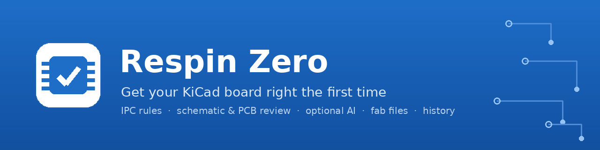
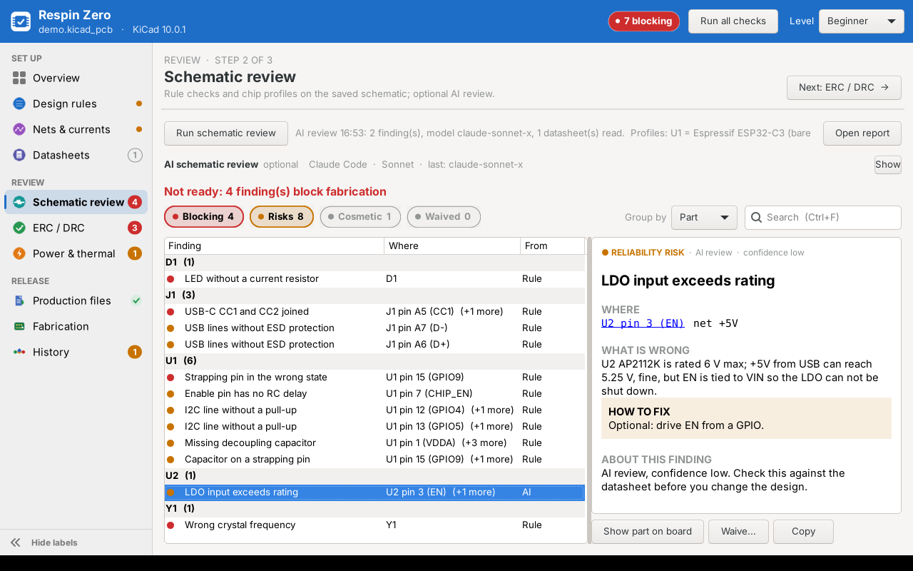
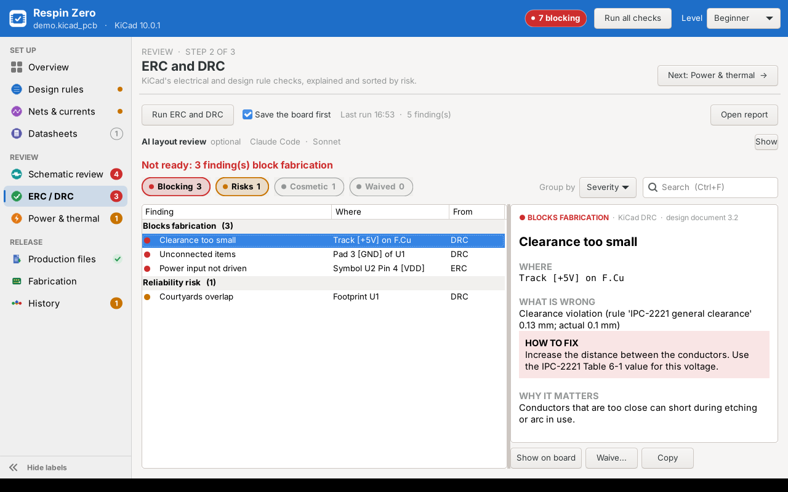

<p align="center">
  
</p>

<p align="center">
  <a href="https://github.com/YOUR-GITHUB-USERNAME/respin-zero/actions/workflows/tests.yml"></a>
  <a href="https://github.com/YOUR-GITHUB-USERNAME/respin-zero/releases"></a>
  
  
  <a href="LICENSE"></a>
  
</p>

<p align="center">
  <b>Get your board right the first time.</b><br>
  A KiCad plugin that takes your board from design rules to fabrication files, with a review at every step.<br>
  Built for embedded engineers who design boards but are not full-time PCB specialists.
</p>

<p align="center">
  <a href="#install">Install</a> ·
  <a href="#features">Features</a> ·
  <a href="#quick-start">Quick start</a> ·
  <a href="#ai-review-optional">AI review</a> ·
  <a href="docs/user-guide.md">User guide</a> ·
  <a href="#roadmap">Roadmap</a> ·
  <a href="CONTRIBUTING.md">Contributing</a>
</p>

---


## Why

Most board re-spins come from a short list of mistakes: a strapping pin pulled the wrong way, a missing pull-up, a crystal with the wrong frequency, a track too thin for its current, a clearance the fabricator cannot make. KiCad's ERC and DRC catch some of them. Respin Zero catches more, explains each one in plain language, and will not let you send files to the fabricator until the blocking ones are fixed or consciously waived.

**Respin Zero** is named after the goal: zero re-spins. It is **one window** inside KiCad, organised in the order you work: **Set up → Review → Release**.

## Features

### Set up
- **Design rules from a few questions.** IPC-2221 spacing and conductor widths, IPC-6012 class, copper weights and board thickness. Every generated rule shows *why* it has that value.
- **Fabricator profiles** for JLCPCB, PCBWay, NextPCB, PCB Power and Lion Circuits (India and China). Rules never go below what your fabricator can make.
- **Beginner, Intermediate and Expert levels.** Beginners get the main questions and explanations; experts can override everything.
- **Nets and currents.** Power, ground and high-voltage nets are found from their names; give a current and get per-net width and clearance rules.
- **Datasheet library** per project, organised in category folders, with the exact part number of each part.

### Review
- **Schematic review** with generic checks (decoupling, I2C pull-ups, USB-C CC resistors, USB ESD, LED current, crystal load capacitors) and **chip profiles** for ESP32-C3, RP2040 and STM32F1 (boot and strapping pins, reset RC, supply range, crystal frequency, debug access). Profiles are JSON files: add your own.
- **ERC and DRC** through `kicad-cli`, sorted into *Blocks fabrication*, *Reliability risk* and *Cosmetic*, each with a fix and the reason it matters.
- **Power and thermal**: track temperature rise, vias per layer change, worst-case voltage drop and thermal-pad vias for every power net.
- **Readable results**: plain titles, filter chips, group by part, a detail card with *what is wrong / how to fix / why it matters*, and a warning when results are out of date.
- **Waivers with a reason**, kept in an audit file you can commit.

| Group findings by part | ERC / DRC explained |
|---|---|
|  |  |

### Release
- **Production files in one click**: Gerbers and drill files in one zip, position file and BOM, in JLCPCB, PCBWay or generic format.
- **Fabrication gate**: final checks (all reviews run on the latest saved files, no blocking findings, outline, layers and thickness within the fabricator's range, every part on the board), then the files and a fab note, saved as a *Sent to fab* version.
- **History with Git**: save versions with milestones, push and pull with your own Git sign-in, a timeline of review progress, and **Compare** two versions (findings fixed and new, parts and nets changed).

| Fabrication gate | History timeline |
|---|---|
|  |  |

### Works with you
- **Sidebar with live status** for every step, keyboard shortcuts (`Ctrl+1…0`, `Ctrl+R`), light and dark mode.
- **Works beside the Schematic Editor** through a desktop launcher (KiCad 10 shows plugins only in the PCB editor).
- **Report a problem** builds a bug report with versions and logs, and no design data.

## Install

**Requirements:** KiCad **10.0** or newer (10.x) on Windows, macOS or Linux. Optional: [Git](https://git-scm.com/) for History, and an AI tool for the AI review.

### From a release (recommended)
1. Download `respin_zero-<version>.zip` from the [latest release](https://github.com/YOUR-GITHUB-USERNAME/respin-zero/releases). Do **not** unzip it.
2. In KiCad, open **Plugin and Content Manager**.
3. Click **Install from File...** and choose the zip.
4. Open your board in the **PCB Editor**. The **Respin Zero** button is on the toolbar.

### From source
```bash
git clone https://github.com/YOUR-GITHUB-USERNAME/respin-zero.git
cd respin-zero
python3 tools/build_zip.py        # writes dist/respin_zero-<version>.zip
```
Then install the zip as above.

### Use it while you work on the schematic
On the **Overview** page press **Shortcut for schematic work...** once. It puts a launcher for the project on your desktop that opens the same window without the PCB editor.

## Quick start

1. **Design rules**: answer the questions, choose your fabricator, press **Apply rules**.
2. **Nets & currents**: give currents to your power nets.
3. Press **Run all checks** (`Ctrl+R`). Fix the red findings first; waive with a reason only what you have checked.
4. **Production files** at any time for a quick quote, or **Fabrication** when you release: final checks, files, and a version.
5. **History**: **Push** to keep the design and its review state on GitHub or GitLab.

The full walk-through is in the [user guide](docs/user-guide.md).

## AI review (optional)

The AI review is **off until you use it** and works with **any AI tool**, using **your own account or a model on your own computer**:

| Tool | Datasheets | Account |
|---|---|---|
| Claude Code | reads the PDFs | Claude Pro / Max |
| OpenAI Codex CLI | page text | ChatGPT account |
| `llm` CLI | page text | OpenAI, Gemini, Mistral, local models… |
| Ollama / LM Studio / llama.cpp (local) | page text | none, runs on your computer |
| Your own command-line tool | your choice | your choice |

**Privacy by design**
- The plugin **never asks for, stores or sends a password, key or token**. Each tool uses its own sign-in.
- **What is sent?** shows the exact text before you send anything. **Never send this project to AI** turns it off per project.
- Tools run without shell access, in an empty temporary folder.
- Every AI finding must name parts, pins or nets that exist in the design, or it is dropped. A low-confidence finding never blocks fabrication.
- For each datasheet, only the pages that matter for the **exact part number** are sent (pin description, absolute maximum ratings, ordering code, application circuit).

AI findings can be wrong. They are marked **AI**, show their confidence, and should be checked against the datasheet.

## Files it creates in your project

| File | Content |
|---|---|
| `<project>.kicad_dru` | Generated rules between marker lines. Your own rules below the markers are kept. |
| `ipc_ste_requirements.json` | Your answers and net groups. |
| `ipc_ste_waivers.json` | Waivers with reason, user and date (commit it). |
| `datasheets/` | The datasheet library. |
| `production/`, `fab/<version>/` | Production and fabrication files. |
| `.respin_zero/findings.json` | Review state of each saved version, for **Compare**. |

## Limits

- **Beta.** Tested with automated tests and on Linux; please report problems on Windows and macOS with **Report a problem**.
- The fabricator BOM and pick-and-place formats follow the fabricators' published upload guides. **Check part rotations in the fabricator's preview** before you order assembly.
- IPC-2221 values are conservative minimums. For mains or patient-connected circuits use IEC 62368-1 or IEC 60601-1 creepage and clearance.
- Fabricator capability values were copied from public pages; check them before you order.
- KiCad 10 does not let plugins change the stackup directly; the plugin edits the board file and you use **File > Revert**.

## Roadmap

- **KiCad 11 support** through KiCad's IPC API, including the Schematic Editor ([plan](docs/roadmap.md)). KiCad 10 stays supported.
- More chip profiles: ESP32-S3, ESP32-C6, nRF52, STM32G0/C0, RP2350, CH32V.
- Medical and safety skill pack (IEC 60601 creepage and clearance, isolation checks).
- Part-number and footprint consistency checks for assembly.

Ideas and votes are welcome in [Discussions](https://github.com/YOUR-GITHUB-USERNAME/respin-zero/discussions).

## Related projects

Respin Zero focuses on a guided, in-KiCad workflow with deterministic checks first and AI as an option. Other good tools you may want next to it:
[kicad-happy](https://github.com/aklofas/kicad-happy) (AI agent skills for deep analysis),
[Konnect](https://github.com/mixelpixx/Konnect) (AI-assisted design over MCP),
[Fabrication Toolkit](https://github.com/bennymeg/Fabrication-Toolkit) and
[KiBot](https://github.com/INTI-CMNB/KiBot) (fabrication outputs and CI).

## Contributing

Bug reports, chip profiles, fabricator formats and translations are all welcome. Read [CONTRIBUTING.md](CONTRIBUTING.md) to get started and the [Code of Conduct](CODE_OF_CONDUCT.md). Security or privacy issue? See [SECURITY.md](SECURITY.md).

## License

[MIT](LICENSE) © 2026 Sourabh Shetty. Bundled third-party code is listed in [THIRD_PARTY_NOTICES.md](THIRD_PARTY_NOTICES.md).

KiCad is a trademark of the KiCad project. This plugin is not affiliated with or endorsed by the KiCad project or by any fabricator named here.
