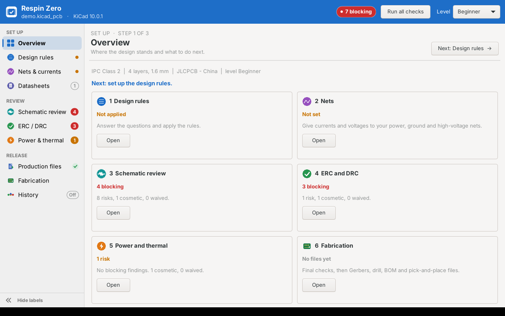
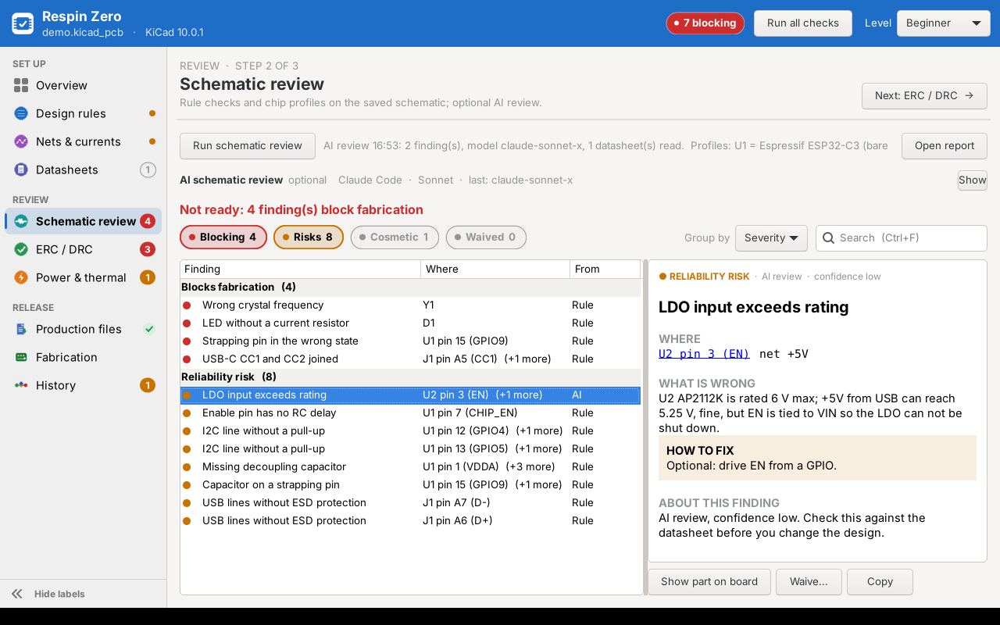
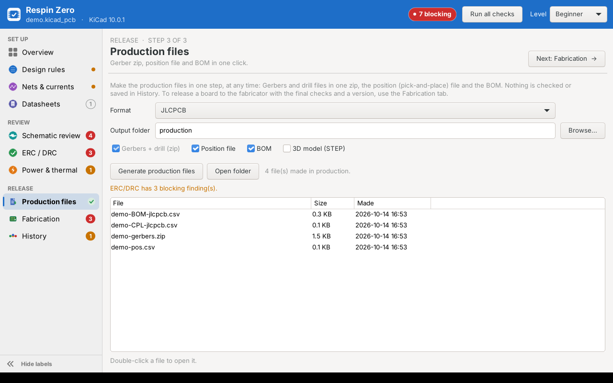
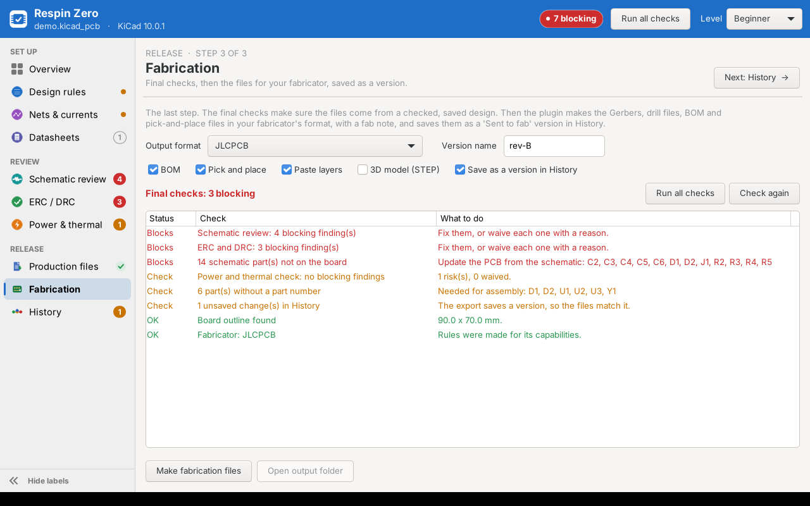
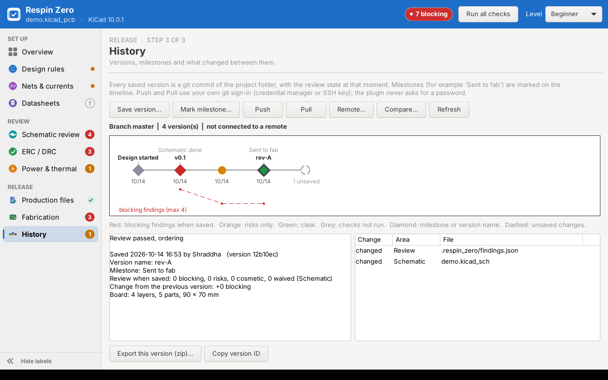

# Respin Zero user guide

This is the same text as the in-plugin help (press **F1** in the window). Back to the [README](../README.md).

Formerly *Board Review Assistant* and *IPC STE Design Assistant*. Updates keep your settings.

One toolbar button opens one window. The **sidebar** groups the pages in the order you work: **Set up** (Overview, Design rules, Nets & currents, Datasheets), **Review** (Schematic review, ERC / DRC, Power & thermal) and **Release** (Production files, Fabrication, History). Each page shows a live badge: a red number for blocking findings, an orange number for risks or unsaved changes, a green tick when done, an orange dot when still to do. The header shows the overall state and **Run all checks**. **Next: ...** at the top right goes to the next step.

Keyboard: **Ctrl+1 ... Ctrl+0** open the pages, **Ctrl+Page Up / Page Down** the previous / next page, **Ctrl+R** runs all checks, **Ctrl+B** hides or shows the sidebar labels, **F1** opens this help. The AI review box is folded to one line until you press **Show**.

**Review pages** (Schematic review, ERC / DRC, Power & thermal) show the results first:
* **Filter chips** with counts (Blocking, Risks, Cosmetic, Waived): click to show or hide.
* **Group by** severity, part (everything about U1 together) or check.
* Each finding has a plain title ("Wrong crystal frequency"), a coloured dot for its severity and where it is.
* The **detail card** on the right: where, what is wrong, how to fix, why it matters (AI findings show their confidence). Click a part to show it on the board.
* An orange bar says when the schematic or board changed after the last run, with **Run again**.
* Keys: **Enter** show on board, **W** waive, **Ctrl+C** copy the finding, **Ctrl+F** search. All tabs share one project profile.

| Tab | What it does |
|---|---|
| **Overview** | Status of each step, the next thing to do, and **Run all checks**. The header shows READY / NOT READY and the experience level. |
| **Design Rules** | IPC questions in groups, presets and fabricator profiles. Fields in red are not valid. **Apply rules** writes `<project>.kicad_dru`, Board Setup constraints and the stackup, and shows every rule with the reason for its value. |
| **Nets** | Finds power, ground and high-voltage nets from their names. Filter, edit the group, current and peak voltage, then **Save and apply rules**. |
| **Datasheets** | Lists the parts of the schematic, grouped by part number or value. Add a PDF, download it from the symbol's Datasheet link, or let **Find matching files** link PDFs that are already in the folder. Files are copied to `datasheets/<category>/` (MCU and modules, Power, Interface and protection, Sensors, Analog, Memory, Connectors, Discrete, Passives, Other). **Send to AI: on/off** per datasheet. |
| **Schematic Review** | Reads the saved schematic through KiCad's own netlist. Generic checks for any design: decoupling, I2C pull-ups, USB-C CC resistors, ESD on USB lines, LED current, crystal load capacitors. Chip profiles add boot/strapping pins, reset/enable RC, supply range, crystal frequency and debug access for ESP32-C3 (chip and modules), RP2040 and STM32F1. **Show part on board** zooms to the part. **Review with AI** (optional) sends a text summary of the netlist, and the datasheets marked for AI, to the AI tool you choose. |
| **ERC / DRC** | Runs ERC and DRC with `kicad-cli` in the background. **AI layout review** (optional): the plugin measures the board (decoupling distance, crystal distance, differential-pair mismatch, power routing, RF module position) and the AI judges the measurements. Filter by *Blocks fabrication*, *Reliability risk*, *Cosmetic* or *Waived*, search, double-click to show a finding on the board, waive with a reason. |
| **Production** | One click, at any time: **Generate production files** makes the Gerbers and drill files in one zip, the position (pick-and-place) file (KiCad format and the fabricator's format), the BOM and, optionally, a STEP model, in the `production` folder (or a folder you choose). Nothing is checked and nothing is saved in History; a line tells you if ERC/DRC is not run, old or blocking. Other files in the folder are kept. |
| **Fabrication** | **Final checks** first: schematic review, ERC/DRC and power check run on the latest saved files, no blocking findings, board outline, layer count and thickness within the fabricator's range, every schematic part on the board, part numbers for assembly, nothing unsaved. Then **Make fabrication files**: Gerbers and drill (zipped), BOM, pick-and-place, optional STEP, and `FAB_NOTE.txt` (board data, final checks, upload notes), in the format of the fabricator (JLCPCB, PCBWay, or generic Gerber X2 for PCB Power, Lion Circuits and others). Files go to `fab/<version name>/` and are saved as a *Sent to fab* version in History. If a final check blocks, you must write a reason; it goes in the fab note and in History. |
| **History** | Version history with git. **Save version** commits the project with a message, an optional milestone (Design started ... Sent to fab ... Release) and version name (for example `rev-A`), and records the review state at that moment (blocking, risks, cosmetic, waived; board size and parts). The **timeline** shows every version (diamond = milestone, colour = review state, dashed = unsaved changes) with a line for blocking findings over time. **Push / Pull** to GitHub, GitLab or any git server with your own git sign-in. **Export this version** writes an old version to a zip; your current files do not change. **Compare...** shows what changed between two versions (or a version and your current files): review findings fixed, new and waived; parts added, removed or changed (value, footprint, part number); nets; board size, layers, parts, tracks and vias; and the changed files. Findings are compared when both versions were saved after the checks ran. |
| **Power & Thermal** | Reads the saved board file. Track temperature rise, vias per layer change, worst-case voltage drop and thermal-pad vias for each power net. A second tab shows the net summary table. |

## Using it while you work on the schematic

KiCad 10 shows plugins only in the PCB editor (KiCad 11 adds schematic plugins). To use the assistant beside the Schematic Editor:

* On the **Overview** tab press **Shortcut for schematic work...** once. It puts a launcher for this project on your desktop. Double-click it to open the same window without the PCB editor.
* Or run `launch.py` (in the plugin folder) with KiCad's own Python and the project file. See the top of `launch.py` for the path on Windows, macOS and Linux.
* Without the PCB editor, everything that reads the saved files works: Schematic Review, Datasheets, AI review, ERC / DRC, Power & Thermal, Nets (net names from the saved board) and History. **Apply rules** writes the rules file only: the Board Setup minimums and the stackup are set when you apply from the PCB editor (so the PCB editor cannot overwrite them). **Show on board** is not available.

## Experience levels

- Change the level in the window header. **Beginner** shows the main questions and presets. Cosmetic findings are hidden. Each finding explains why it matters.
- **Intermediate** adds copper weights, net classes, temperature rise, IPC-7351 density and the fabricator values (read-only when a fabricator is selected). The rules report shows *why* each value was chosen.
- **Expert** can override fabricator values, sees every location in the report, and gets no extra waiver warning.

## AI review (works with any AI tool)

The plugin is not tied to one AI company. It never handles passwords, keys or tokens: each tool uses the account you signed in with in that tool, or runs a model on your own computer. Choose the **Tool** and the **Model** in the AI box. The window shows which model was used for the last review, and the notes record it.

| Tool | Datasheets | Account |
|---|---|---|
| Claude Code | opens the PDFs itself (read-only) | Claude Pro / Max (`claude auth login`) |
| OpenAI Codex CLI | extracted text | ChatGPT account |
| `llm` CLI | extracted text | whatever you set up in llm: OpenAI, Gemini, Mistral, Anthropic, local models (plugins) |
| Ollama CLI | extracted text | none, runs on this computer |
| Local model server (Ollama API, LM Studio, llama.cpp, vLLM, Jan...) | extracted text | none. One entry: the plugin finds a server on the usual ports (11434, 1234, 8080, 8000, 1337). Only `localhost` is allowed. |
| **Your own tool** | your choice | your choice |

* **AI tools...** shows which tools were found and opens your own tools file, `~/.kicad_review/ai_tools.json`. Add any command-line tool there (your company's internal AI CLI, for example) with no code change. You can also replace a bundled tool or hide it (`{"id": "ollama", "disabled": true}`). The file format is described at the top of the file.
* A tool is run directly (no shell), in an empty temporary folder, at low priority. **Cancel** stops it. Project folders cannot define tools, so a downloaded project can never run a command on your computer.
* **Datasheets are matched to the exact part.** The plugin reads each PDF with the bundled `pypdf` (nothing to install) and sends only the pages that matter: the summary, the ordering table with the exact part number (variant, voltage, package), the pin description, absolute maximum ratings, recommended operating conditions, the application circuit and the pages that name the pins you use. Revision history, graphs, package drawings and legal pages are left out. Each page is labelled with why it was chosen, so the AI can cite it.
* The part number comes from the symbol's `MPN` (or `Manufacturer Part Number`, `Mfr Part`) field, else its value. Put the full ordering code in that field for the best result. If the exact number is not in the datasheet, the request says so ("may be the wrong file", or "only the part family found: check the variant").
* Claude Code gets the PDF files and a list of the pages to read first. Other tools get the text of those pages. Text from tables can be garbled. Read text is cached in `datasheets/.cache`. Limits: 12 files, 40 MB, about 150 000 characters in total.
* If you are signed in to a Claude plan and `ANTHROPIC_API_KEY` is also set, the plugin removes the key for the review so your plan is used, not API billing.
* **What is sent?** shows the exact text, the skills and the datasheets.
* Every AI finding must name parts, pins or nets that exist in the design. Findings that name anything else are dropped and listed in the notes. A low-confidence finding is never marked *Blocks fabrication*.
* **Never send this project to AI** turns the feature off for one project (saved in `ipc_ste_requirements.json`).
* AI findings can be wrong, and small local models make more mistakes. They are marked **AI** in the *Check* column. Check each one against the datasheet.
* **Layout review** (ERC / DRC tab): language models are poor at geometry, so the plugin measures the layout and sends the measurements, not raw coordinates. The DRC and Power & Thermal findings are sent too, so the AI does not repeat them.

### Skills (your own review rules)

* A skill is a Markdown file with rules, for example company layout rules or a medical checklist. The AI follows the ticked skills.
* Project skills: `<project>/review_skills/` (commit them with the design). Personal skills: `~/.kicad_review/skills/` (all projects).
* Each `*.md` file, or each folder with a `SKILL.md` file, is one skill. Optional front matter: `name`, `description`, `applies_to: schematic | pcb | both`.
* **Skills...** lists them; tick or untick per project, add files, or start from a template. **What is sent?** shows which skills go with the request.

## Files in your project folder

| File | Content |
|---|---|
| `<project>.kicad_dru` | Generated rules between the marker lines. **Put your own rules below the markers. The plugin keeps them.** A later rule wins, so your rules override the generated ones. A `.bak` copy of the last file is kept. |
| `ipc_ste_requirements.json` | Your answers and net groups. |
| `ipc_ste_waivers.json` | Waived findings, with reason, user and date. Keep it in version control. |
| `ipc_ste_manufacturers.json` | Optional. Your own or corrected fabricator profiles (same format as the bundled `manufacturers.json`). |
| `<project>-ipc-ste-report.txt` | The last ERC/DRC report, including the waiver audit record. |
| `<project>-review-schematic.txt` | The last schematic review report. |
| `kicad_review_profiles/*.json` | Optional. Your own chip profiles (see `profiles/README.md`). A profile with the same `id` replaces the bundled one. |
| `<project>-ipc-ste-power.txt` | The last Power & Thermal report with the net summary. |
| `production/` | The last files from the Production tab (kept out of History by the `.gitignore`). |
| `fab/<version name>/` | Fabrication files and `FAB_NOTE.txt` for each version sent to fab. |
| `.respin_zero/findings.json` | The open and waived findings when the version was saved, for **Compare**. |
| `.gitignore` | Added by **Start version history**: keeps KiCad backups, `.history`, caches, local settings and generated reports out of git. |
| `datasheets/<category>/*.pdf`, `datasheets/index.json` | The datasheet library and which part each file belongs to. Commit it with the design. |
| `<project>.kicad_pcb.ipcste.bak` | Backup made before the wizard changes the stackup in the board file (KiCad 10). |

## Fabrication and production files

## History

## Problems

**Report a problem...** on the Overview tab makes a text with the plugin, KiCad, Python and OS versions, which tools were found and the end of the log (`~/.kicad_review/logs/respin_zero.log`). It has no part, net or file contents; your home and project folders are shortened. Read it, then copy or save it for a bug report.

## Own fabrication formats

Add or correct a fabricator's output format in `~/.kicad_review/fab_presets.json` (same format as the bundled `fab_presets.json`; the same `id` replaces a bundled entry). Check the fabricator's current upload guide before you order.

## Limits

- The schematic review needs the schematic saved. Chip profiles cover ESP32-C3, RP2040 and STM32F1 so far; other ICs get the generic checks. Every profile names its datasheet source.

- KiCad 10 does not let plugins change the stackup. The wizard saves the board, edits the stackup in the file, and you use File > Revert.
- Power & Thermal uses IPC-2221 estimates. Via current treats the barrel as an internal conductor (about 1 A for a 0.3 mm via at 10 C). The voltage drop is an upper limit (all track of the net in series).
- The plugin does not change the copper layer count. It tells you if the answers and the board differ.
- Conductor widths use the IPC-2221 equation, which is conservative on inner layers. Make sure with an IPC-2152 calculator.
- IPC spacing is a minimum. For mains or patient-connected circuits, use the creepage and clearance from IEC 62368-1 or IEC 60601-1.
- Fabricator values were copied from public capability pages on the date shown. Make sure they are current before you order.
- History uses your installed `git`. It never asks for or stores a password or token; set up Git Credential Manager or an SSH key once. KiCad files cannot be merged automatically, so work on one branch or take turns.
- Bundled: pypdf 6.20.1 (BSD 3-Clause, `vendor/pypdf/LICENSE`).
- This plugin uses KiCad's SWIG Python API, which KiCad plans to remove in version 11.
